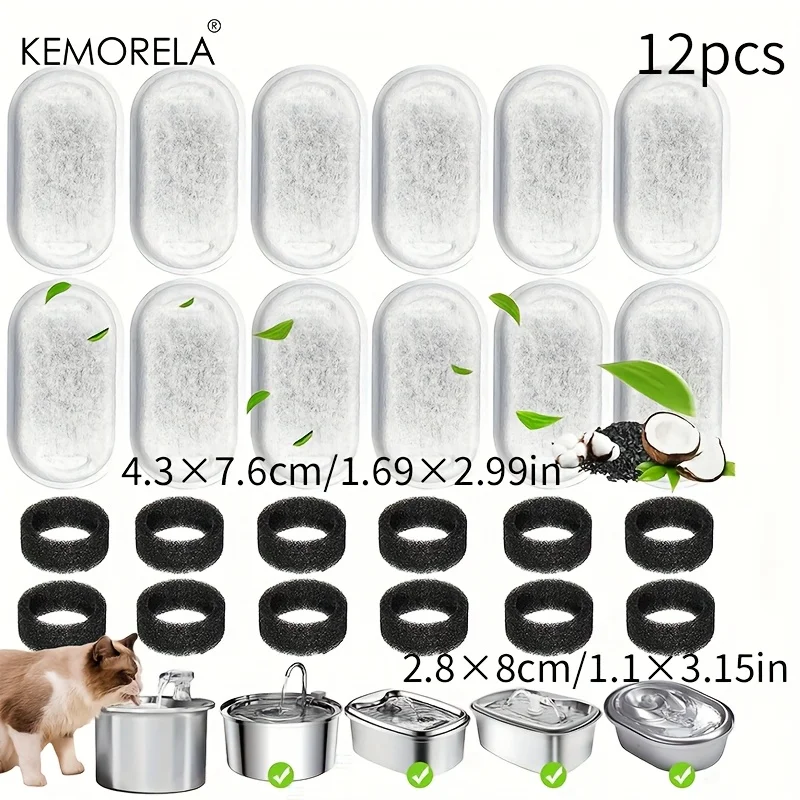
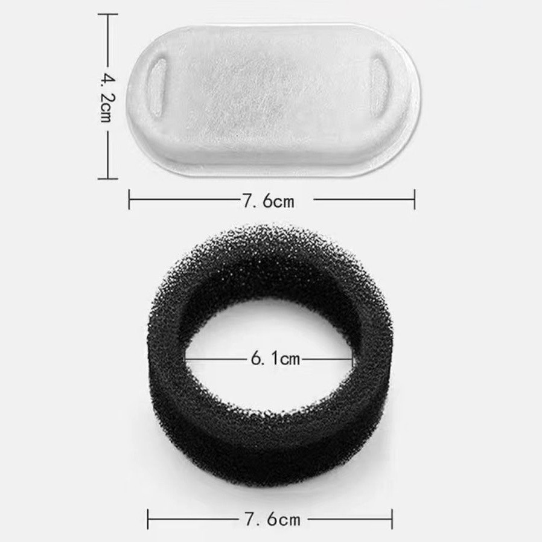
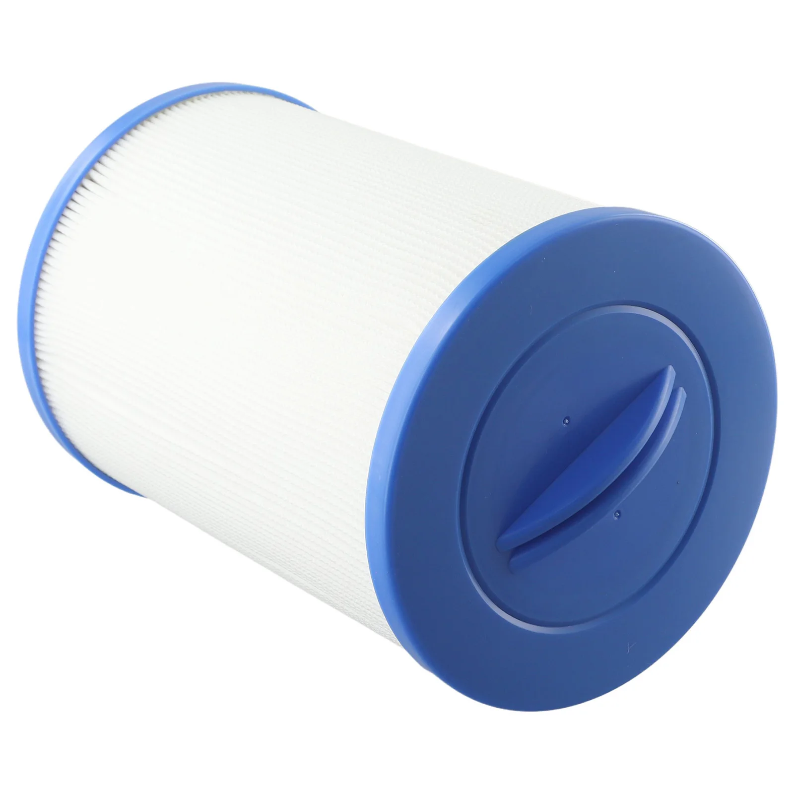
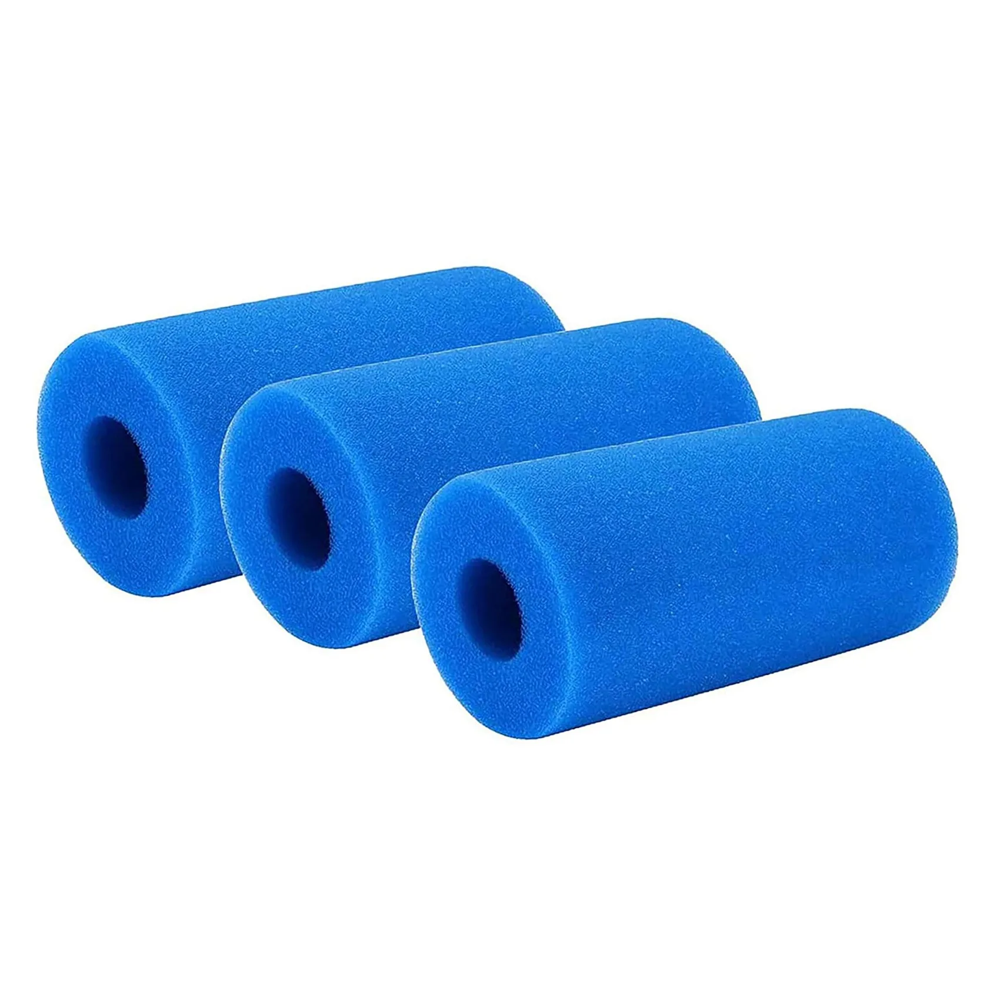
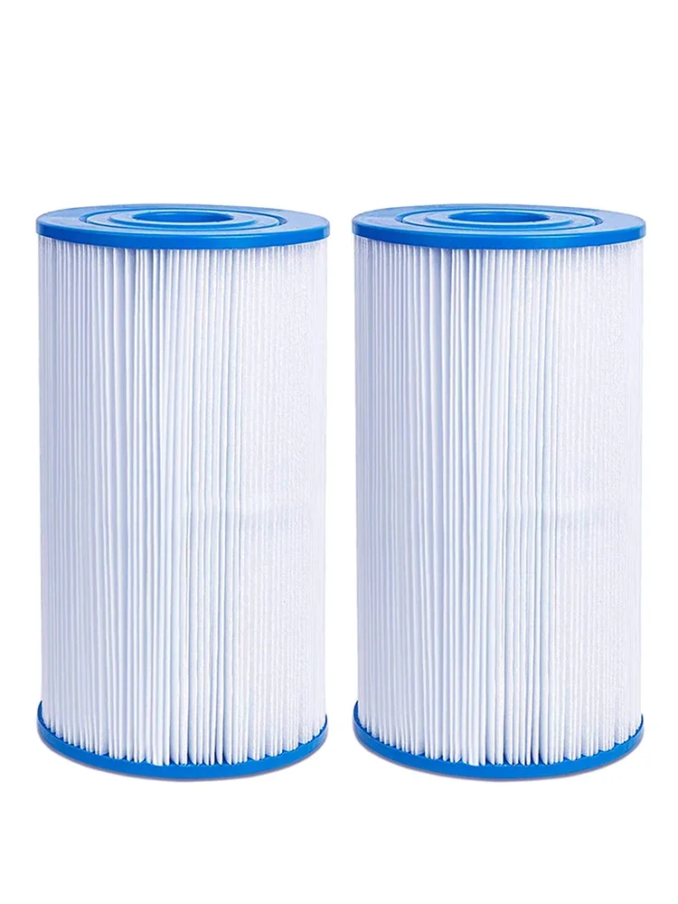
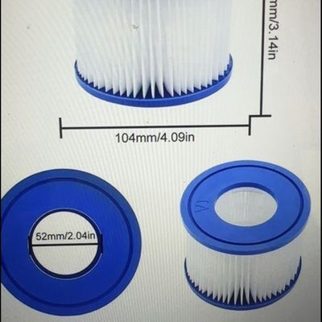

# 推荐SKU深度分析（双语）/ Recommended SKUs — Bilingual Analysis
2026-10-22。对象：从新品类调研中筛出的5个「适合本店做」的小芯SKU（大芯已排除：体积大、运费吃利润、压库存）。价格均为市场锚，未做利润核验（待用户货源价+货代运费报价）。
Scope: the 5 small-cartridge SKUs selected for this store (large cartridges excluded: bulky, freight-heavy, inventory-hungry). All prices are market anchors, NOT margin-verified.

---

## SKU 1 ★主推 — 宠物跑道款滤芯 / Pet Fountain Filter (Runway Style)

 

中文分析：
- 速卖通头部已验证：12支 $4.75、5,000+单、4.9分/593评（item 3256809687957501）；同梯队 $6.69/2,000+单、$3.69（6支）/1,000+单。亚马逊（间接核验）不锈钢饮水机通用款 6+6套装 $11.99、20支 $15.99 — 海外价格天花板明显高于速卖通。
- 货源（拼多多，4条同款不同店）：R1 ¥4.82/5片（¥0.96/片，热销1525件）；R4 的12套装是热销SKU；实测尺寸：滤片 7.6×4.2cm、海绵圈外径7.6/内径6.1cm；单片重 8g（用户实测）。
- 账：用户现有货源报价 ¥30/12片（¥2.5/片）太高 — R1 零售都只要 ¥0.96/片。压到 ¥1.2/片以内：12套装卖 $9.99，标准线毛利约 $3.24（32%）；24套装 $15.99 毛利约 $5.78（36%）。现报价下 $8.99 标准线仅 $0.11，等于白干。
- 为什么排第一：2–4周一换，复购是全品类最强；8克一片，运费几乎不计；尺寸单一，不压SKU。

EN summary: Proven AliExpress head (5,000+ sold at $4.75/12pc). PDD retail floor is ¥0.96/pc — sourcing must land ≤¥1.2/pc; at that level a 12-set pack at $9.99 yields ≈$3.24 margin on standard shipping. Highest repurchase rate in the category (2–4 week replacement), 8 g per pad, single size. Rank #1.

## SKU 2 ★主推 — SPA芯 6CH-940 / Spa Filter Cartridge 6CH-940 (PWW50)

中文分析：
- 速卖通：$10.06（划线$31.76）、600+单、4.8分/31评（item 3256809056696580）— 小芯里客单价最高的一款。形态（主图已目验）：白色百褶+蓝色端盖+顶部提手。
- 货源（拼多多6条，型号对口3条）：通用款 796808333555、跨境款 963920718294（标题带「跨境」，最像出口供货）、PWW50/FC-0172款 963992100539。价格待登录补抓。
- 注意：SPA是全年品（热水浴缸不分季节），不像泳池芯有强淡旺季；交叉号 PWW50 / 6CH-939 / P36 是标题流量入口。尺寸本轮未实测，下单前拿样核对（外径/长度/顶口形态）。

EN summary: Highest unit price among small cartridges on AliExpress ($10.06, 600+ sold). Three model-matched PDD sources found, incl. one export-oriented listing. Year-round demand (hot tubs), cross-numbers PWW50 / 6CH-939 drive search traffic. Verify dimensions with a sample before bulk order.

## SKU 3 补充 — Intex A型可洗海绵芯 / Washable Sponge Filter for Intex Type A

中文分析：
- 速卖通：3支 $2.02（划线$6.02）、600+单、4.5分/97评（item 3256807627180505），$0.67/支；同类 Evolver $3.25/494单。卖点是「可洗重复用」替代纸芯。
- 货源：拼多多无此款（已多关键词确认），走1688。海绵体积大但极轻，运费按体积/重量取大者时要注意抛比 — 压缩打包是关键。

EN summary: 600+ sold at $2.02/3-pack; the "washable & reusable" angle differentiates it from paper Type A. No PDD source — source on 1688. Foam is light but bulky: vacuum/compressed packing matters for freight.

## SKU 4 补充（季节款）— Type A/C 纸芯2支装 / Type A/C Paper Cartridge 2-Pack

中文分析：
- 速卖通：$3.10（划线$17.21）、800+单、4.4分/101评（item 3256807086899977），$1.55/支 — 充气池纸芯的经典走量款。
- 货源：拼多多无独立SKU（只有 Bestway 专用 HAPA 款沾边），走1688（出口专供品）。
- 强季节性：欧美5–7月峰值，现在是淡季 — 3月前备货上架即可，不急。

EN summary: The classic volume SKU for inflatable pools ($3.10/2-pack, 800+ sold). No PDD source; 1688 only. Strongly seasonal (May–Jul peak in EU/US) — list and stock by March.

## SKU 5 补充 — Bestway VI型 / Filter Cartridge VI (Bestway / Lay-Z-Spa)

中文分析：
- 速卖通专用款仅 $2.74/195单 — VI 的量主要在亚马逊 Lay-Z-Spa 品牌渠道和线下，速卖通独立量级一般，只做补充SKU。
- 货源是这5个里拼多多最齐的：964748371796（泳池设备畅销榜第5）、699661766597、354067937010，另有 HAPA 款 1013739016731。适配号 90352 / 58323。

EN summary: Standalone AliExpress volume is modest (195 sold) because VI demand sits in brand channels; keep as a supporting SKU only. Best PDD sourcing coverage of the five (incl. a category bestseller-list item). Cross refs: 90352 / 58323.

---

## 排期 / Roadmap
中文：① 跑道款先行（压货源到¥1.2/片内就上12/24套装）；② 6CH-940 拿样核尺寸后上；③ 海绵+A/C+VI 赶在3月泳池季前上。
EN: 1) Pet runway first, once sourcing ≤¥1.2/pc. 2) 6CH-940 after sample size check. 3) Sponge + A/C + VI before the March pool-season ramp.
