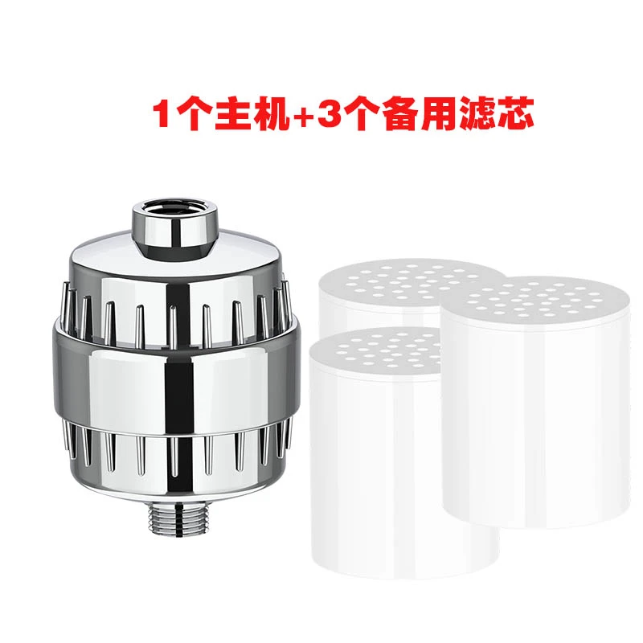
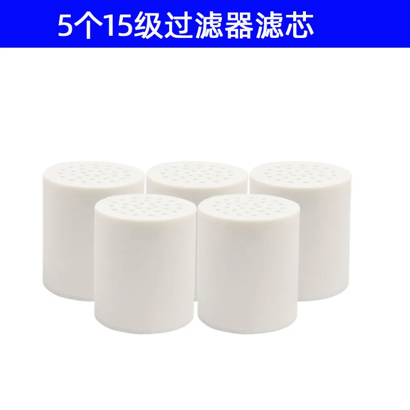
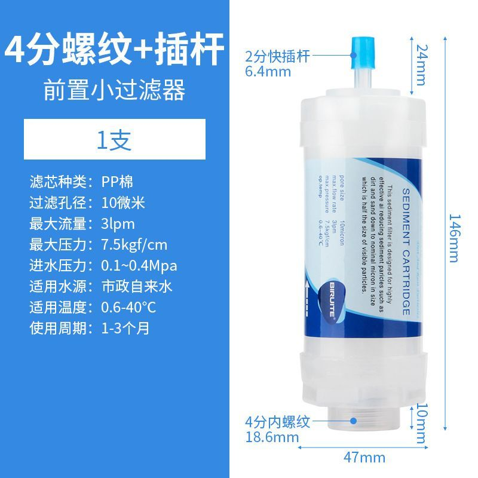
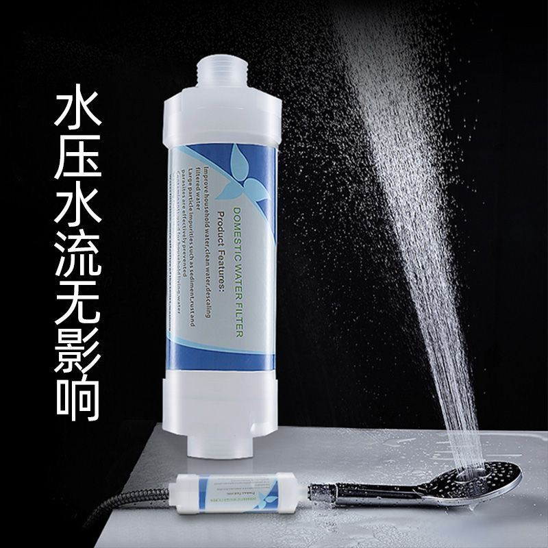
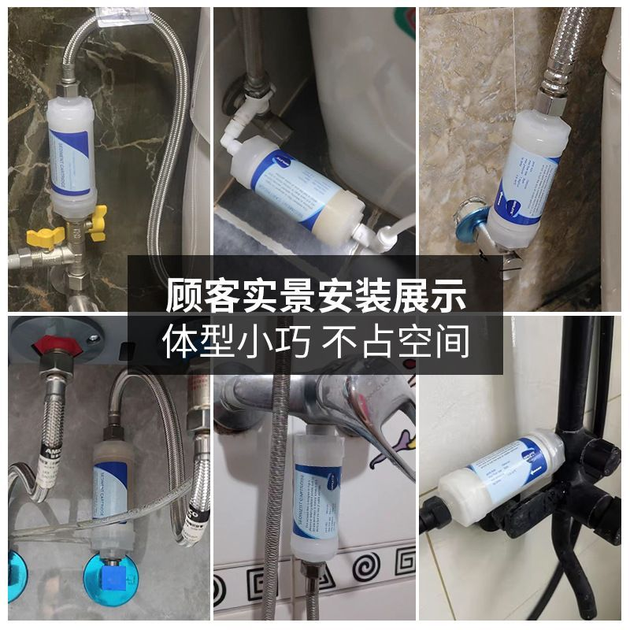

# 用户分享8条拼多多链接分析（双语）/ User-Shared PDD Links — Bilingual Analysis
2026-10-22，用户分享、登录后逐条核对。分两组：A组=15级花洒过滤器整机（5条同款不同店）；B组=前置小过滤器PP芯（3条同类）。
Two groups: A = 15-stage shower filter unit (same design, 5 shops); B = inline PP sediment pre-filter cartridges (3 similar listings).

---

## A组 花洒过滤器整机（15层级）/ Shower Filter Unit, 15-Stage

 

中文分析：
- 同一款设计（电镀外壳整机+白色圆柱滤芯），5家店在卖，价格带拉得很开：¥16.7（好运莱，大促价，带滤芯的变体已售罄，本店已拼452件）→ ¥17.9（韵美星，热销1444件，量最大）→ ¥25.19（译康，总售仅1件）→ ¥39（SOIJOT官方旗舰店，已拼408件）→ ¥65.31（谨辰，券后限量价，本店仅46件，定价脱离市场）。
- 真实成交带 = ¥17–18（整机）。SKU结构统一：整机1个 / 整机+备用滤芯1/2/3个 / 纯滤芯装 — 卖的是「整机+耗材复购」。
- 对应海外：这就是 AquaBliss 型15级花洒过滤器（亚马逊 $18.99–22.99，间接核验）。此前花洒类目结论是「只做整机+滤芯组合、不做散芯引流款」— A组正好是这个组合的货源：拼多多零售 ¥17 的整机，批发再往下，组合装（整机+3芯）在速卖通打 $19.99–24.99 有空间（利润待运费核验：整机含金属壳，重量需实测）。

EN summary: One design sold by 5 shops; the real transaction band is ¥17–18 per unit (the ¥39/¥65 listings are brand/outlier pricing). SKU logic everywhere = unit + spare-cartridge bundles. This is the AquaBliss-type 15-stage shower filter (Amazon $18.99–22.99). It fits the earlier "shower = combo only" verdict: a Unit + 3 Cartridges bundle at $19.99–24.99 on AliExpress is the play; verify unit weight (metal shell) before margin sign-off.

明细 / Details:
- S1 460383600470 韵美星 ¥17.9（单独购买¥45）热销1444件 — 主力货源
- S2 397042997647 SOIJOT旗舰店 ¥39（单独¥45）已拼408件 — 品牌溢价
- S3 1018802490454 谨辰 券后¥65.31 本店已拼46件 — 价格异常，忽略
- S4 1008312326834 好运莱 ¥16.7（原¥23.88）已抢24件 — 最低价，但带芯变体售罄
- S5 1016062895708 译康 ¥25.19 总售1件 — 基础款/升级款/加厚款

## B组 前置小过滤器（PP沉淀芯）/ Inline PP Sediment Pre-Filter

  

中文分析：
- 3条是同一类：直插式PP棉沉淀前置小过滤器，用于洗衣机/热水器/智能马桶盖/花洒进水口。S6主图带完整规格（已目验）：PP棉10微米、最大流量3 lpm、最大压力7.5 kgf/cm²、进水压力0.1–0.4 MPa、适用温度0.6–40°C、寿命1–3个月；长146mm、外径47mm、下口4分内螺纹（18.6mm）、上口2分快插杆（6.4mm）— 双接口设计，标签自带英文（SEDIMENT CARTRIDGE），明显是出口型产品。
- 价格：3条在网页端都是简化页、只显示 ¥8.?? / ¥5.?? / ¥7.??（提示去App看），真实价待App确认；广东发货。
- 判断：这款和用户主业（前置/全屋滤芯）同源，体积小、规格标准化、韩系市场走量大，值得作为小芯线的一个SKU候选；先把App真实价拿到再算账。

EN summary: Inline PP sediment cartridges (146 x 47 mm, 10 µm, 3 lpm, dual fitting: 1/2" female thread + quick stem) for washing machines, water heaters, smart toilet seats and shower inlets. The label is already in English — an export-oriented product. Web prices are App-masked (¥5–8 range); confirm exact prices in the PDD app before costing. Strong fit with the store's pre-filter core line.

明细 / Details:
- S6 413754131910 大促价 ¥8.??（App可见）广东发货 — 规格图最全，做规格基准
- S7 667997312949 大促价 ¥5.??（App可见）ABS壳，使用对象标注花洒
- S8 895160717529 限1件 ¥7.??（App可见）主打智能马桶滤芯

## 结论 / Verdict
中文：A组解决「花洒只做组合」缺的货源（¥17整机）；B组是前置小芯的现成出口款（规格全、双接口）。两组都比大芯适合本店。下一步：A组称重+问批发价；B组拿App真实价。
EN: Group A supplies the shower-combo strategy (unit at ~¥17 retail). Group B is a ready-made export pre-filter cartridge with full specs. Both fit the store far better than large cartridges. Next: weigh the shower unit + ask wholesale pricing; get exact app prices for Group B.
